# UI/UX changes

Nine changes on `apps/web`, each with a reason. Screenshots are taken at
390 px (phone) and 1100 px (desktop) with a headless Chrome against the Vite
dev server and a stub of the payment-link API (the stub only answers the two
checkout calls; the declined card ends in `0002`). "Before" is the code at
`3ef637d`, "after" is the tip of `submission`.

| # | Commit | What was wrong | What changed |
|---|---|---|---|
| 1 | `10c93e3` checkout form | On a phone the CVV box ran off the right edge, the month label wrapped, the card number was one 16-digit blob, CVV was visible, the browser could not autofill, errors were silent for screen readers, help text was 4.4:1 contrast | Inputs size to their column (grid), card number grouped in fours (digits only go to the API), CVV masked and capped at 4 digits, `autocomplete` tokens (`cc-number`, `cc-exp-month`, `cc-exp-year`, `cc-csc`), `role="alert"` on errors, visible focus ring, 4.5:1+ help text, clear primary button |
| 2 | `445b661` dashboard times | `toLocaleString()` used the viewer's zone, so a payment could show on a different day than the settlement report | Times render in Asia/Bahrain; the layout says "Times are shown in Bahrain time (UTC+3)". Test fails on the old code when the browser zone is not Bahrain |
| 3 | `3be814f` checkout success | Showed a raw ISO string (`2026-10-30T14:02:51.585Z`) and never said how much was paid | Receipt-style screen: amount, merchant, reference, readable Bahrain time, receipt number |
| 4 | `f1b485f` refund drawer | Errors not announced, amount box needed a click, no quick way to refund the remainder | Amount focused on open, `role="alert"` errors, "Use full amount" button; a partial refund is still a typed amount |
| 5 | `ac8a78b` transaction list | The list had no refund information, amounts were left-aligned (9.990 vs 1234.567 could not be compared) and `partially_refunded` had no colour | New Refunded column, right-aligned tabular money columns (also in the event timeline), status shown as words |
| 6 | `884415c` dashboard on phones | At 390 px the detail page and event table were wider than the screen and clipped the status; no visible keyboard focus; current page only bold | Detail rows stack, tables scroll inside themselves, focus ring, underline bar on the current nav item, primary submit buttons |
| 7 | `46ea668` minimal restyle | Pages looked unfinished: browser-default controls, heavy table grid, mixed button styles | CSS only, no new elements: one neutral palette, white cards, soft status pills, quiet table headers, dark primary buttons, focus halo, short transitions; checkout as a centred card |
| 8 | black + red theme | Team wanted a stronger identity than neutral grey | CSS only, no new elements, dashboard + checkout + admin: black (#09090b) surfaces, white text, red (#dc2626) for primary buttons, focus and the active nav item; sharp 2px corners; statuses are outlined tags (white = money moved, dashed = waiting, red = stopped). shadcn/Tailwind was considered and rejected for tonight: it means rewriting every component; the same look is achieved with plain CSS on the existing React markup |
| 9 | `855a065` + polish (Abdu, merged `25cc0c8`) | Top-bar navigation did not scale to 6 sections on a phone; native date fields varied by browser; pages had inconsistent spacing and controls | Shared theme (`apps/shared-ui/theme.css`, Inter font): left sidebar navigation with the current section marked, phone tab bar, one `DateInput` with a calendar button and DD/MM/YYYY entry, row links with arrows, consistent cards and status pills across merchant, admin and checkout. Polish on merge: status filters as toggle chips, statuses shown as words, skip-to-content link only on keyboard focus |

## Before / after

Dashboard screenshots use a stub of the merchant API with six sample
transactions (login, list, and the refund drawer open on a partially refunded
payment). "Before" for the dashboard is `d66ffb9`, so it already contains
the Bahrain-time and refund-drawer commits above.

| Screen | Before | After |
|---|---|---|
| Desktop, transactions | 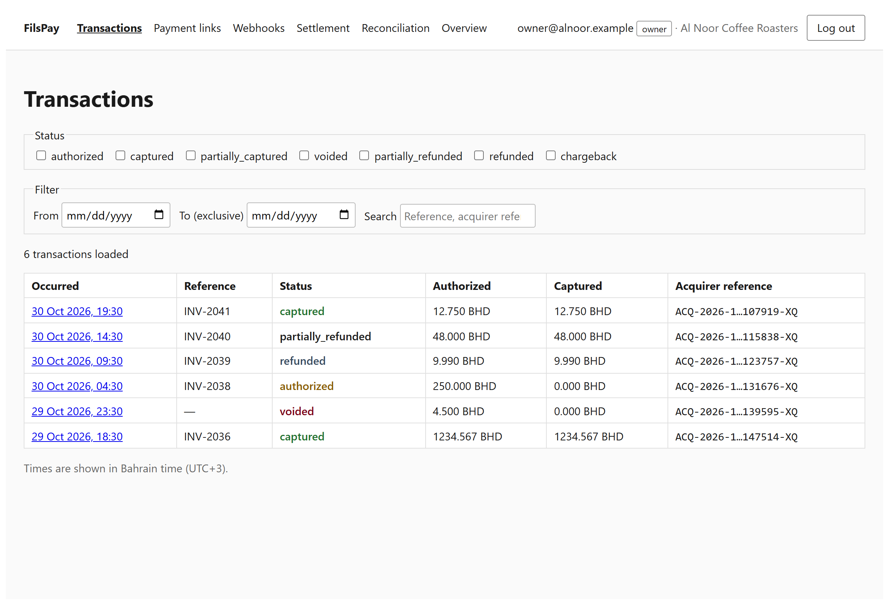 | 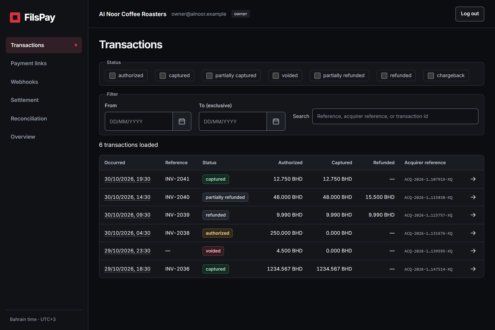 |
| Phone, transaction detail with refund open | 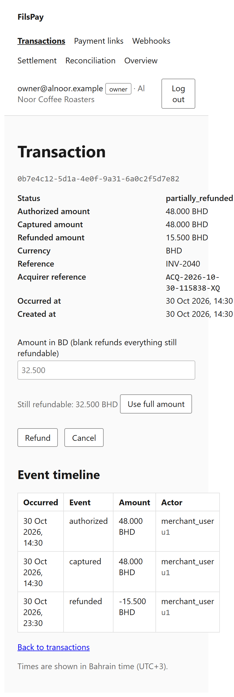 | 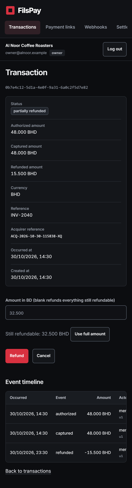 |
| Phone, sign-in | 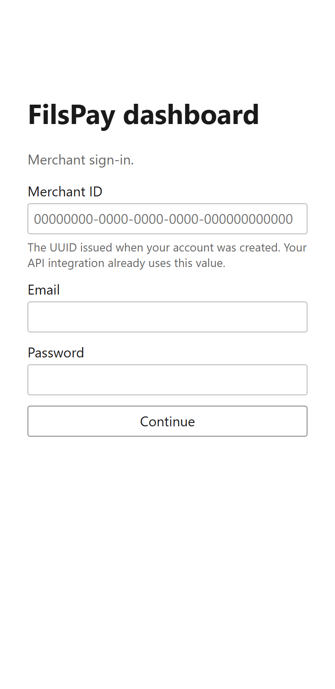 | 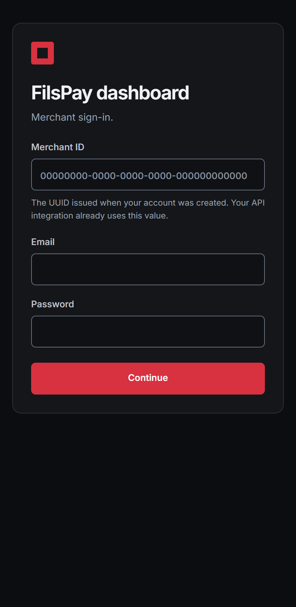 |

Checkout (stub of the payment-link API):

| Screen | Before | After |
|---|---|---|
| Phone, filled form | 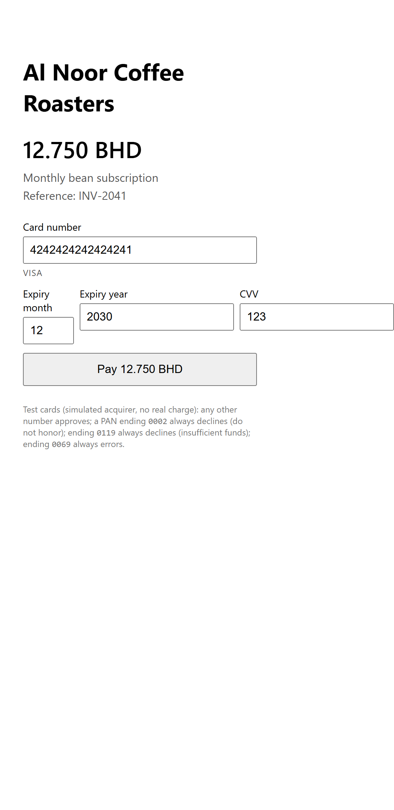 | 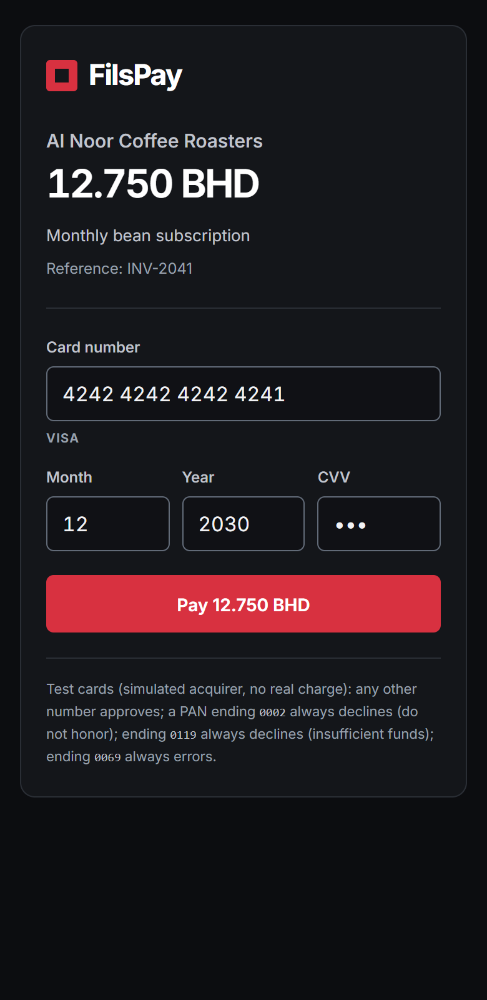 |
| Phone, success | 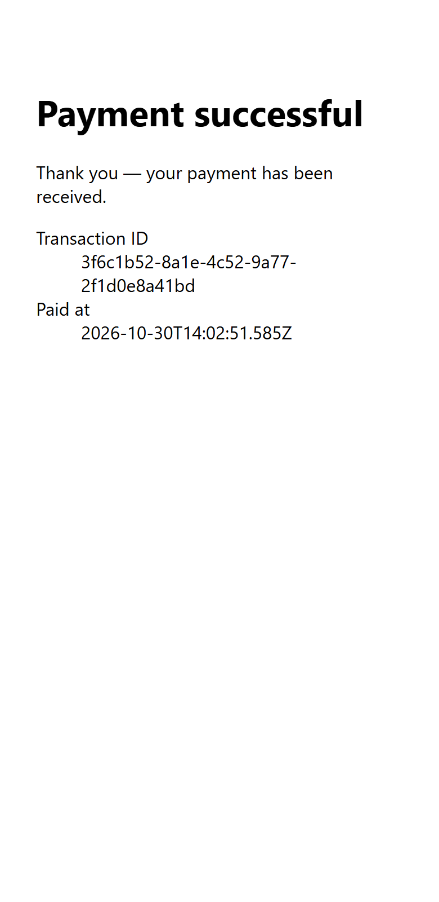 | 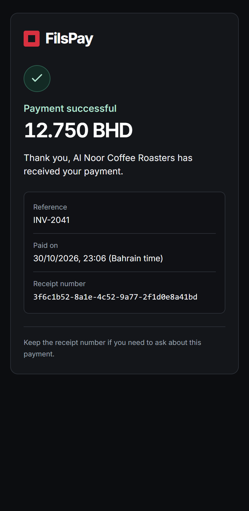 |
| Desktop, form |  | 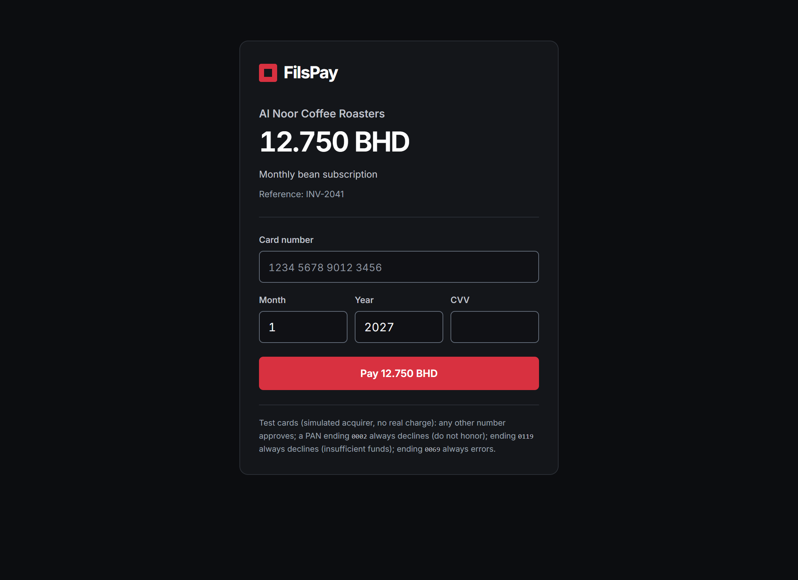 |
| Desktop, declined | 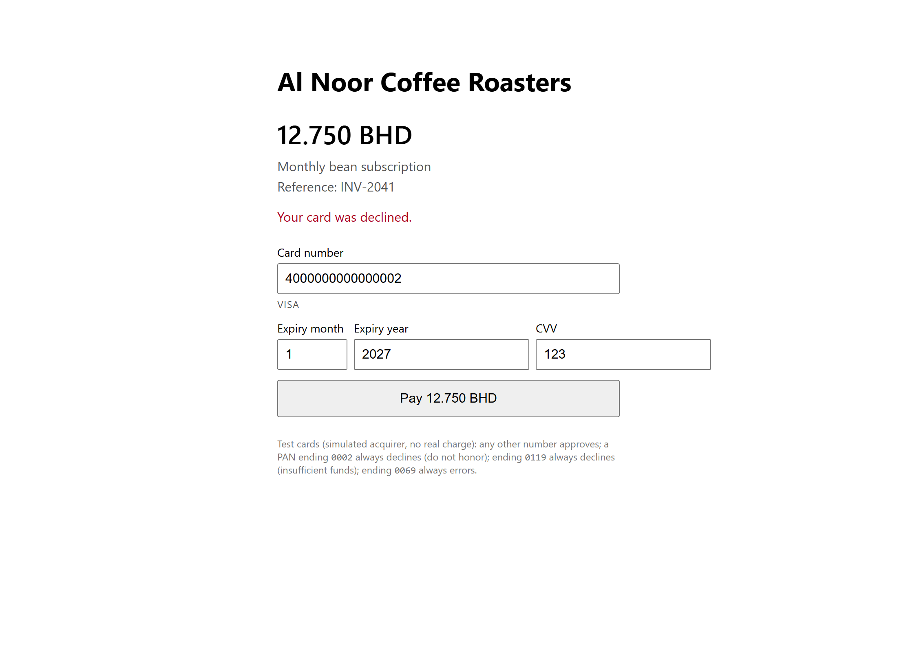 | 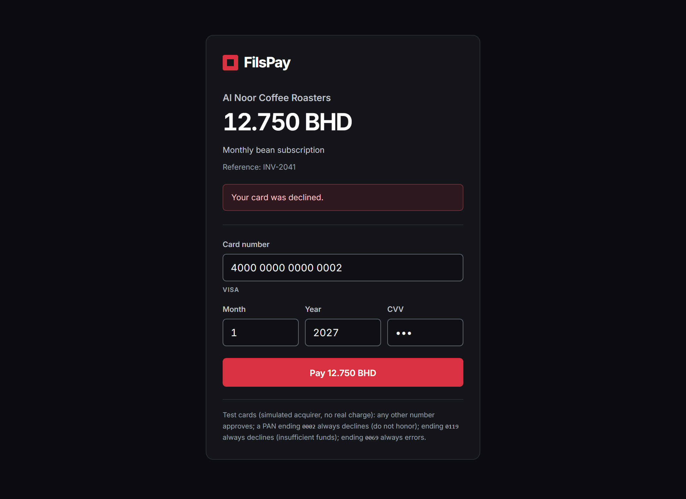 |

The other screens (processing, desktop success, phone form and declined) are
in `docs/ui/` with the same names.

## Not changed, on purpose

* The dashboard was screenshotted against a stub API, not the real one; the live server run should re-check the same three screens.
* The checkout still prints the simulated-acquirer test-card help text. It is
  true and useful for the demo; remove it for a real launch.
